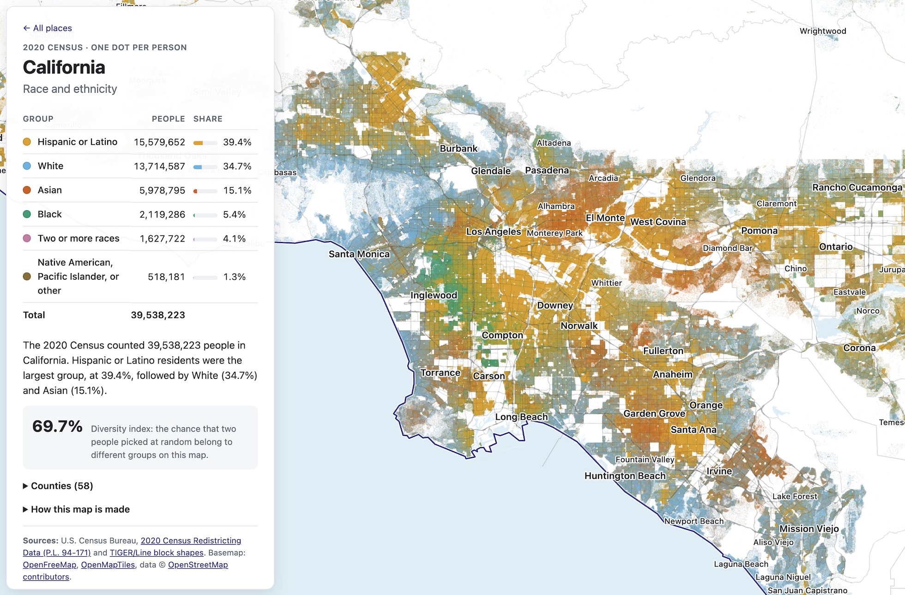

# Open dot map



A racial and ethnic dot map built entirely from open data and open-source
parts: one dot per person from the 2020 Census, placed at random inside the
census block where they were counted.

Currently covers **California**: a state page (`site/california.html`), all
58 county pages, and an index (`site/index.html`). Add states to `STATES` in
`pipeline/config.py` and re-run `make` to cover more.

## Run it

```sh
make            # set up Python, download Census data, build dots, tiles, and pages
make serve      # http://localhost:8000 (supports range requests for PMTiles)
```

Or open `site/` through any web server (the page loads JSON, so `file://`
won't work). Re-running steps: `make dots`, `make tiles`, `make site`.

California takes about 1 minute for dots and 2 minutes for tiles on an
8-core laptop, and produces 23,729 tiles (192 MB as a folder, 128 MB as
`site/tiles.pmtiles`).

## How it works

| Step | Script | Output |
|---|---|---|
| Download Census files for each state | `pipeline/download.py` | `data/raw/` |
| Place one dot per person in their census block | `pipeline/make_dots.py` | `data/work/dots/<fips>.npz` |
| Render tiles that store each pixel's group shares, in parallel | `pipeline/render_tiles.py` | `site/tiles/`, `site/tiles.pmtiles`, `site/data/tileset.json` |
| Write outlines, totals, and HTML pages | `pipeline/build_site.py` | `site/data/*.json`, `site/*.html` |

On any page, hover over a county to see its name and population, and click it
to switch the page to that county in place (the URL and back button follow
along). The clickable outlines come from `site/data/counties-<state>.json`.

Tiles hold group shares and density, not colors, so the page applies any
palette exactly, including blends. Colors, labels, the optional color
picker, and the tile source (folder or PMTiles) live in
`site/assets/config.js`. States, zoom levels, and worker count live in
`pipeline/config.py`.

For hosting, switch `tiles` in `site/assets/config.js` to `"tiles.pmtiles"`
and upload `site/` without the `tiles/` folder. The single file needs a host
that supports HTTP range requests (Apache, nginx, S3, Cloudflare R2, GitHub
Pages).

## Publishing on GitHub Pages

`.github/workflows/pages.yml` rebuilds everything on each push to `main`
(Census downloads, dots, tiles, pages) and publishes `site/` to GitHub Pages
with `tiles.pmtiles`. Tiles are never committed. One-time setup: in the repo's
Settings → Pages, set Source to "GitHub Actions". Census downloads are cached
between runs. To publish the tile folder instead of the PMTiles file, run the
workflow manually (Actions → Build and publish site → Run workflow) and pick
`folder`.

GitHub Pages sites are limited to 1 GB, which fits California (~130 MB) but
not the whole US. For larger builds, host `tiles.pmtiles` on Cloudflare R2 or
S3 and point `tiles` in `site/assets/config.js` at its URL.

## Sources and licenses

- Code in this repository: MIT (see `LICENSE`).
- Population: U.S. Census Bureau, 2020 Census Redistricting Data (P.L. 94-171), public domain.
- Change since 2020: U.S. Census Bureau Population Estimates, county characteristics by race and Hispanic origin (Vintage 2025), public domain. Set `PEP_VINTAGE` in `pipeline/config.py` when a new vintage is released.
- Block and county shapes: U.S. Census Bureau TIGER/Line and cartographic boundary files, public domain.
- Basemap: [OpenFreeMap](https://openfreemap.org) vector tiles, [OpenMapTiles](https://openmaptiles.org) schema, data © [OpenStreetMap contributors](https://www.openstreetmap.org/copyright) (ODbL; attribution required).
- [OpenLayers](https://openlayers.org) (BSD 2-Clause), `site/vendor/ol/`.
- [Huebee](https://huebee.buzz) (MIT), `site/vendor/huebee/`.
- [PMTiles](https://github.com/protomaps/PMTiles) reader (BSD 3-Clause), `site/vendor/pmtiles/`; Python writer used by the pipeline.
